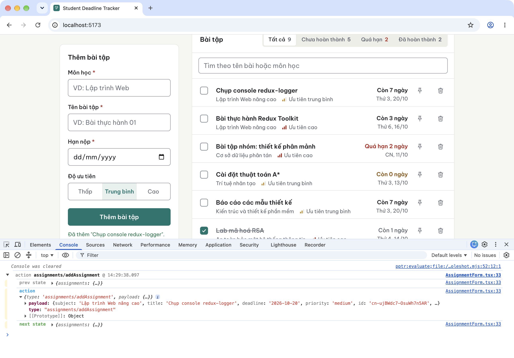
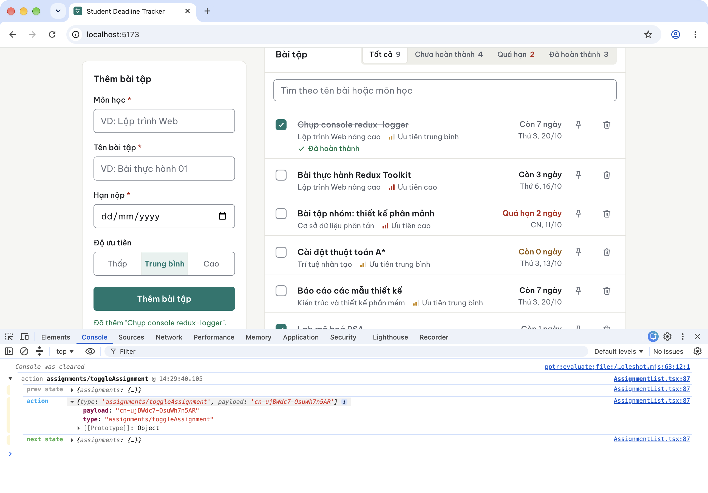
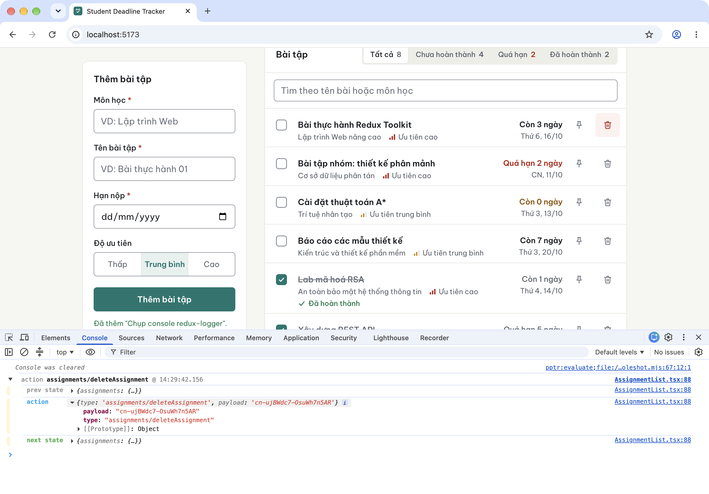

# Báo cáo kiểm tra và đo hiệu năng — Bài thực hành 02

Student Deadline Tracker · LTWNC · Ngày đo: 13/10/2026

## 0. Môi trường và phiên bản đo

| Mục | Giá trị |
|---|---|
| Máy | Apple M1 Pro, RAM 32 GB, macOS |
| Trình duyệt | Google Chrome 154.0.8037.98 (headless) |
| Node.js | 20.19.6 |
| Lighthouse | 13.5.0, cấu hình mặc định (Mobile). Navigation: throttling `simulate`; Timespan: throttling `devtools` |
| Bản sau Phần A (chưa tối ưu) | commit `593f20c` — *TH B2 bước 1* |
| Bản sau Phần B (đã tối ưu) | commit `b7031a3` — *TH B2 bước 2* |

Thứ tự làm: **Phần A → đo trên bước 1 → Phần B → đo lại trên bước 2**. Bản bước 1 đã có nút "Tạo 10.000 bài tập mẫu", ô tìm kiếm và trang Thống kê, nhưng chưa áp kỹ thuật tối ưu nào. Có vậy mới đo được "trước tối ưu".

Mỗi phép đo chạy **3 lần** trên trang mới mở. Bảng ghi **trung vị** của 3 lần. Số liệu từng lần nằm trong [du-lieu/](du-lieu/).

---

## 1. Phần A — Kiểm tra quản lý state (bản bước 1)

### 1.1 Đổi theme không làm re-render component không liên quan

**Cách đo:** gắn hook `__REACT_DEVTOOLS_GLOBAL_HOOK__` (chính là cơ chế React DevTools Profiler dùng để nhận commit). Sau mỗi commit, script duyệt cây fiber và đếm những component thực sự chạy hàm render. Một component được tính khi nó được xử lý trong lần render đó và có cờ `PerformedWork`, nghĩa là không bị `memo` hay bailout bỏ qua. Script: [scripts/renders.mjs](scripts/renders.mjs).

**Thao tác:** tải trang, đợi 8 bài mẫu hiện, rồi bấm nút "Chế độ tối".

| | Bước 1 | Bước 2 |
|---|---|---|
| Số commit khi bấm đổi theme | 1 | 1 |
| Component đã render trong commit đó | `ThemeProvider` (1), `ThemeToggle` (1) | `ThemeProvider` (1), `ThemeToggle` (1) |
| `App`, `AssignmentForm`, `FilterTabs`, `AssignmentList`, `AssignmentCard`… | không render | không render |

Kết quả giống nhau ở cả 3 lần chạy và cả 2 bản. Lý do: `ThemeContext` tách riêng, `value` bọc `useMemo`, và cây `<App>` truyền vào `ThemeProvider` qua `children` ([ThemeProvider.tsx](../src/theme/ThemeProvider.tsx)). Màu đổi bằng CSS variable theo thuộc tính `data-theme` trên `<html>`.

### 1.2 redux-logger: thêm, hoàn thành, xoá một bài tập

**Thao tác** (bản dev `npm run dev`, script [scripts/logger.mjs](scripts/logger.mjs)): nhập form, bấm "Thêm bài tập", tick hoàn thành bài vừa thêm, rồi xoá nó (chấp nhận hộp xác nhận).

Console ghi được, nguyên văn ở [du-lieu/redux-logger-console.txt](du-lieu/redux-logger-console.txt). Để dễ đọc, phần `prev state` / `next state` được script tóm tắt thành số bài và trạng thái của bài đầu danh sách:

```text
▼ action assignments/addAssignment @ 14:06:36.733
    prev state { assignments: { items: [8 bài; bài đầu: "Bài thực hành Redux Toolkit", completed: false], filter: 'all', status: 'succeeded', error: null } }
    action     {"type":"assignments/addAssignment","payload":{"subject":"Lập trình Web nâng cao","title":"Đo hiệu năng redux-logger","deadline":"2026-10-20","priority":"medium","id":"nxHbnWcG4h6boynSP-0oS","completed":false}}
    next state { assignments: { items: [9 bài; bài đầu: "Đo hiệu năng redux-logger", completed: false], ... } }
▼ action assignments/toggleAssignment @ 14:06:37.157
    prev state { assignments: { items: [9 bài; bài đầu: "Đo hiệu năng redux-logger", completed: false], ... } }
    action     {"type":"assignments/toggleAssignment","payload":"nxHbnWcG4h6boynSP-0oS"}
    next state { assignments: { items: [9 bài; bài đầu: "Đo hiệu năng redux-logger", completed: true], ... } }
▼ action assignments/deleteAssignment @ 14:06:37.624
    prev state { assignments: { items: [9 bài; bài đầu: "Đo hiệu năng redux-logger", completed: true], ... } }
    action     {"type":"assignments/deleteAssignment","payload":"nxHbnWcG4h6boynSP-0oS"}
    next state { assignments: { items: [8 bài; bài đầu: "Bài thực hành Redux Toolkit", completed: false], ... } }
```

Chạy cùng thao tác trên bản production (`npm run build && npm run preview`): **0 dòng log**. Logger chỉ bật ở môi trường development.

**Ảnh chụp console.** Chụp nguyên cửa sổ Chrome thật (có giao diện) trên máy đo: bên trên là trang, bên dưới là DevTools → Console. Object `action` được mở rộng để thấy payload. Trước mỗi thao tác, console được xoá để mỗi ảnh chỉ có 1 action. Ảnh chụp trên bản bước 2 (`b7031a3`); `store.ts` giống hệt bước 1 nên logger hoạt động như nhau. Script: [scripts/consoleshot.mjs](scripts/consoleshot.mjs).

**Thêm bài tập** (`assignments/addAssignment`; tab "Tất cả" 8 → 9, bài mới ở đầu danh sách):



**Hoàn thành bài tập** (`assignments/toggleAssignment`; "Đã hoàn thành" 2 → 3):



**Xoá bài tập** (`assignments/deleteAssignment`; "Tất cả" 9 → 8):



### 1.3 Ghim bài tập (Zustand)

Kiểm chứng bằng test tự động (không phải phép đo hiệu năng):
- [usePinStore.test.ts](../src/features/pins/usePinStore.test.ts): `togglePin` / `isPinned`, bài ghim lên đầu.
- [AssignmentCard.test.tsx](../src/features/assignments/components/AssignmentCard.test.tsx): bấm nút ghim → store cập nhật, `aria-pressed` đổi.
- [AssignmentList.test.tsx](../src/features/assignments/components/AssignmentList.test.tsx): bài vừa ghim đứng đầu danh sách.

---

## 2. Phần B — Đo trước và sau tối ưu

### 2.1 Phương pháp

**A. Số lần render** (thay cho Profiler; bản dev, viewport 1280×900, cùng hook như mục 1.1):
1. Tải trang, đợi 8 bài mẫu.
2. Bấm "Tạo 10.000 bài tập mẫu", đợi tab "Tất cả" hiện 10008, chờ thêm 1,5 s.
3. Bấm vào ô tìm kiếm, gõ `bài` (mỗi phím cách nhau 150 ms), chờ 1,5 s.

Thời gian commit lấy từ `actualDuration` của fiber gốc. Đây là số của bản dev nên chỉ dùng để so sánh tương đối.

**B. Lighthouse** (bản production `vite build` + `vite preview`, script [scripts/lh.mjs](scripts/lh.mjs)):
- **Navigation:** tải trang và bấm nút tạo 10.000 bài ngay khi nút xuất hiện. Cách này cho điểm Performance của *trang danh sách đang có 10.000 bài*. Sau mỗi lần chạy, script kiểm tra tab "Tất cả" = 10008 và cả 6/6 lần đều đúng.
- **Timespan:** trang đã tải xong, bắt đầu ghi, bấm tạo 10.000 bài, gõ `bài` vào ô tìm kiếm, rồi dừng ghi.

### 2.2 Số lần render `AssignmentCard`

| Chỉ số (trung vị 3 lần) | Trước (bước 1) | Sau (bước 2) |
|---|---|---|
| **Gõ `bài` vào ô tìm kiếm (10.008 bài)** | | |
| Số lần `AssignmentCard` render | **15.151** | **28** |
| Số lần `AssignmentList` render | 3 | 5 |
| Số commit | 3 | 7 |
| Commit lâu nhất (ms, bản dev) | 1.144,9 | 39,0 |
| Tổng thời gian render các commit (ms, bản dev) | 2.360,4 | 73,3 |
| Số thẻ trong DOM sau khi lọc | 4.002 | 14 |
| **Bấm "Tạo 10.000 bài tập mẫu"** | | |
| Số lần `AssignmentCard` render | 10.008 | 14 |
| Commit lâu nhất (ms, bản dev) | 1.966,7 | 20,8 |
| Số phần tử DOM của trang | 239.232 | 419 |

Đọc kết quả:
- **Trước:** 3 phím gõ tạo 3 commit, mỗi commit lọc lại 10.008 bài và render lại mọi thẻ khớp từ khoá. Tổng cộng 15.151 lần render thẻ.
- **Sau:** cả 3 lần chạy đều ra đúng 28, trong khi DOM chỉ có 14 thẻ đang hiển thị. Như vậy chỉ có các thẻ trong khung nhìn render lại, sau khi ngừng gõ 300 ms. Kiểm tra thêm bằng Jest (jsdom, bản bước 2): `AssignmentCard` **render 0 lần trong lúc đang gõ**, chỉ render sau khi debounce kết thúc.
- `AssignmentList` render nhiều hơn (3 → 5) vì giờ nó giữ thêm state `debouncedQuery`. Nhưng mỗi lần render chỉ tốn vài ms, vì các thẻ đã được `memo` và danh sách đã ảo hoá.

### 2.3 Lighthouse

| Chỉ số (trung vị 3 lần) | Trước (bước 1) | Sau (bước 2) |
|---|---|---|
| **Navigation — trang có 10.008 bài** | | |
| **Điểm Performance** | **68** | **98** |
| First Contentful Paint | 1.856,9 ms | 1.659,2 ms |
| Largest Contentful Paint | 1.856,9 ms | 1.803,6 ms |
| Total Blocking Time | 4.905,1 ms | 14,5 ms |
| Speed Index | 2.528,8 ms | 1.659,2 ms |
| Cumulative Layout Shift | 0 | 0 |
| Số phần tử DOM | 239.201 | 412 |
| Thời gian main thread | 9.584,6 ms | 682,5 ms |
| **Timespan — tạo 10.000 bài + gõ `bài`** | | |
| Điểm Performance (Timespan) | 45 | 97 |
| Total Blocking Time | 16.458,6 ms | 160,1 ms |
| Interaction to Next Paint | 9.354,8 ms | 221,9 ms |
| Cumulative Layout Shift | 0,044 | 0 |
| Thời gian main thread | 18.239,3 ms | 493,2 ms |

Điểm Navigation 3 lần: bước 1 = 68 / 68 / 61; bước 2 = 98 / 98 / 99. Report HTML (mở bằng trình duyệt) của lần chạy có TBT bằng trung vị:
[buoc1-navigation.html](lighthouse/buoc1-navigation.html) · [buoc1-timespan.html](lighthouse/buoc1-timespan.html) · [buoc2-navigation.html](lighthouse/buoc2-navigation.html) · [buoc2-timespan.html](lighthouse/buoc2-timespan.html)

### 2.4 Kích thước bundle (output `npm run build`)

| | Trước (bước 1) | Sau (bước 2) |
|---|---|---|
| JS chính | 278,17 kB (gzip 88,58 kB) | 289,42 kB (gzip 92,60 kB) |
| Chunk `StatsPage` (tải khi mở trang Thống kê) | — (nằm trong JS chính) | 1,99 kB (gzip 0,84 kB) |

JS chính tăng khoảng 4 kB gzip vì có thêm thư viện `react-window`. Trang Thống kê tách ra được 0,84 kB gzip. Mức này nhỏ so với phần react-window thêm vào, nên `React.lazy` ở đây mang tính minh hoạ kỹ thuật nhiều hơn là tiết kiệm đáng kể.

### 2.5 Kỹ thuật đã áp dụng và tác dụng thấy được

| Kỹ thuật | Tác dụng thể hiện trong số liệu |
|---|---|
| Virtualization (`react-window`, từ 100 bài) | DOM giảm từ khoảng 239 nghìn còn khoảng 410 phần tử; thời gian main thread và TBT giảm mạnh nhất |
| `useDebounce` 300 ms + `useMemo` cho phần lọc | Không lọc lại và không render thẻ trong lúc đang gõ; chỉ lọc 1 lần sau khi ngừng gõ |
| `React.memo` (`AssignmentCard`) + `useCallback` (handler) | Thẻ có props không đổi được bỏ qua: đổi theme, gõ phím, render lại `AssignmentList` đều không làm thẻ render |
| `React.lazy` + `Suspense` (Thống kê) | Tách chunk `StatsPage` 1,99 kB, chỉ tải khi mở trang |

Không tách riêng được phần đóng góp của từng kỹ thuật, vì cả 4 kỹ thuật cùng nằm trong một commit.

---

## 3. Giới hạn của phép đo

- Số lần render được đếm bằng hook tự viết, theo cùng cơ chế với React DevTools Profiler, nhưng không phải chính extension. Nếu cần ảnh chụp Profiler, mở DevTools và làm lại đúng kịch bản ở mục 2.1. Số lần render sẽ khớp, còn thời gian sẽ khác tuỳ máy.
- Thời gian commit (mục 2.2) đo ở bản dev nên chậm hơn production. Lighthouse (mục 2.3) đo ở bản production.
- Lighthouse chạy giả lập Mobile (CPU chậm khoảng 4 lần) theo mặc định, nên các số ms lớn hơn khi dùng máy thật.
- Kịch bản Navigation có bấm nút ngay lúc tải trang, nên không phải phép đo "chỉ tải trang".
- Khi đo, mình phát hiện **lỗi ở bản dev**: `import logger from 'redux-logger'` qua Vite nhận về cả object module, khiến `configureStore` báo lỗi và trang trắng. Đã sửa thành `import { logger } from 'redux-logger'` trước khi đo, và sửa luôn vào commit bước 1. Bản production không bị ảnh hưởng, vì build ra file giống hệt nhau (cùng hash `index-D4ZFA0Be.js`).

## 4. Chạy lại phép đo

Script trong [scripts/](scripts/) cần `puppeteer-core@25.13.0` và `lighthouse@13.5.0`. Hai gói này không có trong `package.json` của dự án, nên cài ở một thư mục riêng.

```bash
# 2 terminal, mỗi bản một thư mục (checkout commit 593f20c hoặc b7031a3)
npm run dev                              # → node renders.mjs http://localhost:5173/ 3
npm run build && npm run preview         # → node lh.mjs http://localhost:4173/ buoc1 3 ./out
node logger.mjs http://localhost:5173/   # log redux-logger
```
